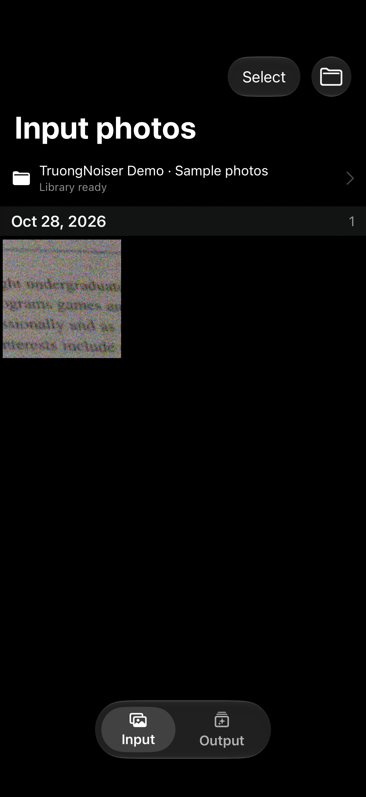
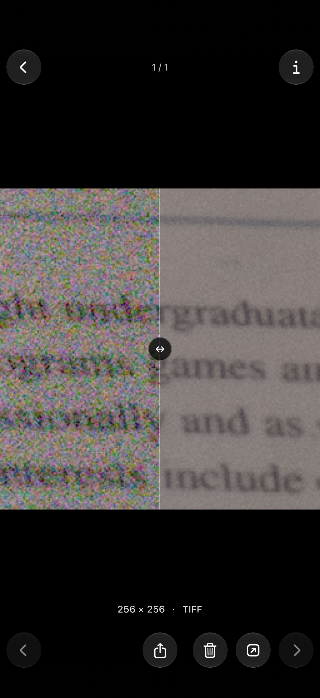
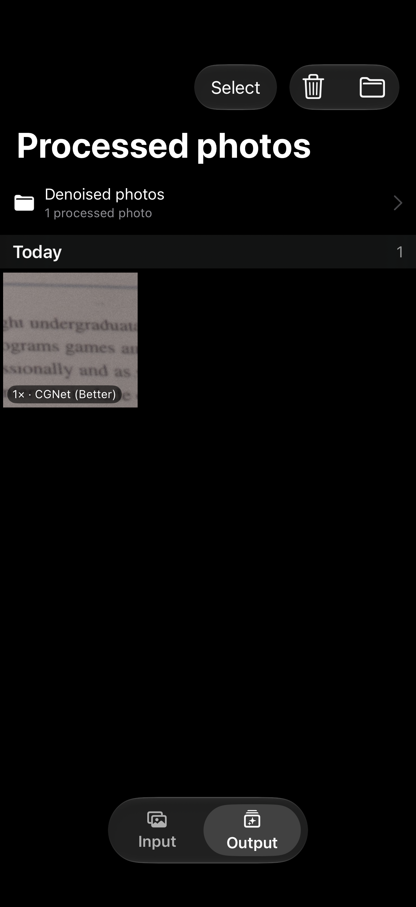
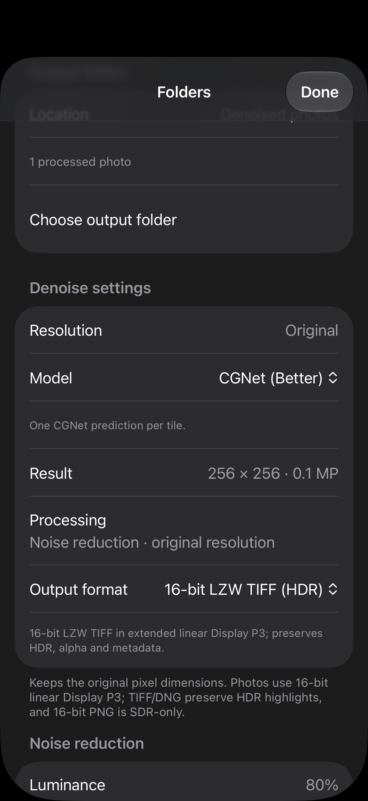
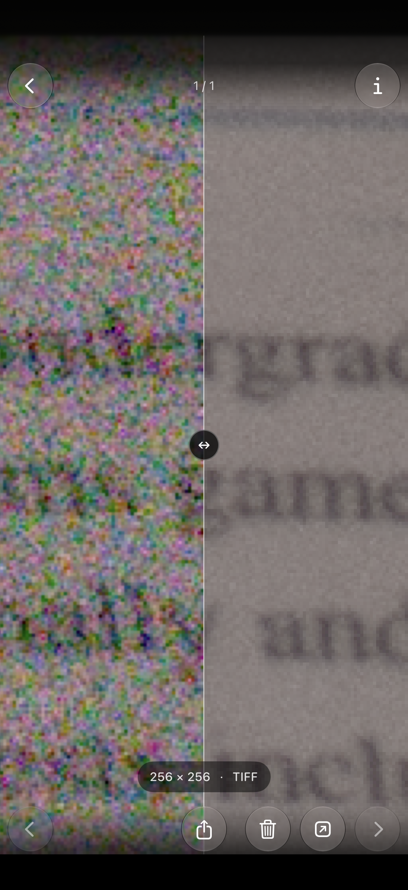

<div align="center">


# TruongNoiser

Native-resolution iPhone photo noise reduction with local Core ML models, independent luminance/color controls and a before/after library in Files.

[Download latest IPA](https://github.com/iant4093/TruongNoiser/releases/latest/download/TruongNoiser.ipa) · [Releases](https://github.com/iant4093/TruongNoiser/releases) · [Build status](https://github.com/iant4093/TruongNoiser/actions) · [Report an issue](https://github.com/iant4093/TruongNoiser/issues)

[](https://github.com/iant4093/TruongNoiser/releases/latest/download/TruongNoiser.ipa)


[](https://github.com/iant4093/TruongNoiser/actions/workflows/ci.yml)

</div>

---

TruongNoiser keeps the original pixel dimensions and offers **NAFNet (Fast)** by default, **CGNet (Better)** and **CGNet (Best, 8-pass)**. Choose an input folder and a separate output folder in Files. Set luminance and color strength before processing; each saved result retains its model, applied strengths, processing history and frozen original for before/after comparison when reopened. Inference runs locally using trained models and Apple frameworks.

The app bundles **three choices and four compiled variants**, with 256 and 512 input shapes for each network. Both CGNet modes share the same weights; Best averages eight oriented predictions of the same input, then applies strengths once. Tier names describe intended tradeoffs; controlled phone quality/speed comparisons and accelerator placement remain unmeasured.

**Open in TruongScaler** sends a self-contained photo/history document through the native Open In menu. Update both apps for the companion document types. Each receiver verifies and owns its imported copy; this path does not depend on shared App Group signing. Native menu/lifecycle and byte-import tests passed locally; actual transfer between signed apps on a phone remains unmeasured.

## Screenshots

Five actual production SwiftUI/UIKit screens captured in an iOS Simulator at 1206 × 2622 use the pinned upstream NAFNet noisy demonstration image. The viewer reopens a freshly processed native-resolution CGNet result through its portable record; the detail view zooms the same aligned original/result pair, with noisy input on the left and denoised output on the right. Settings show CGNet (Better) and independent strength controls. Screens illustrate the interface and this example; they do not establish physical-phone performance or general image-quality superiority. Upstream credits, license notices, source hashes and capture details are in [screenshot provenance](docs/screenshots/provenance.json).

<table>
  <tr>
    <td width="50%" valign="top">
      
      <p align="center"><sub><b>Input library</b> · browse photos from a chosen Files folder</sub></p>
    </td>
    <td width="50%" valign="top">
      
      <p align="center"><sub><b>Before and after</b> · compare the saved original with its denoised result</sub></p>
    </td>
  </tr>
  <tr>
    <td width="50%" valign="top">
      
      <p align="center"><sub><b>Output library</b> · reopen, share and manage saved results</sub></p>
    </td>
    <td width="50%" valign="top">
      
      <p align="center"><sub><b>Processing settings</b> · choose the model, strengths and export format</sub></p>
    </td>
  </tr>
  <tr>
    <td colspan="2" align="center" valign="top">
      
      <p align="center"><sub><b>Noise detail</b> · zoom into the same saved before/after pair; input left, denoised right</sub></p>
    </td>
  </tr>
</table>

## Features

**Processing**

- Native 1× noise reduction, preserving the input pixel dimensions
- NAFNet-width64 SIDD, CGNet SIDD and an eight-orientation CGNet mode, with 256/512 input memory tiers
- Independent luminance and color strengths, initially **80% / 100%**, frozen and recorded for each job
- Required trained Core ML weights with pinned provenance, SHA-256 verification and complete upstream license notices
- Recursive input folders containing supported photos and RAWs, including loose files outside a camera-app library
- Disk-backed canvases, overlapping tiles, durable checkpoint/journal recovery and Stop between predictions
- Batch progress that includes saving each photo, with retained native background-task and Live Activity integration
- Linear Display P3 reconstruction with HDR headroom and alpha kept outside the network
- Rendered Linear DNG, half-float LZW TIFF, 16-bit SDR PNG, runtime-verified HDR HEIC and SDR JPEG export

**Library**

- Separate Input and Output collections with folder bookmarks, selection and swipe navigation
- Zoomable before/after viewing that retains the result's recorded model, applied strengths and actual dimensions
- Automatic portable result records and deduplicated, byte-frozen originals for persistent comparisons
- Small browsing previews that preserve full-resolution processing and exports
- Sharing of saved result bytes without another export, plus an explicit Save Original to Photos action
- Recoverable Recently Deleted, batch Restore and confirmed permanent deletion for Output photos
- Bounded processing history and supported EXIF/GPS metadata carried through exports
- Companion photo/history documents with source ownership, saved-output SHA-256 verification and validated native modal lifecycle handling; both updated apps are required

The SIDD networks consume developed gamma-sRGB; RAW input is decoded first. HDR/wide-gamut reconstruction restores the network's linear-light residual onto the original pixels. RAW decoding depends on the installed Apple runtime and camera format. **Real Canon EOS R7 CR3 files have not been exercised**; extension recognition does not establish camera compatibility. Gain-map HDR raster inputs are refused when native decoding returns only their SDR base; linear DNG/TIFF provide separate HDR paths. PNG is SDR-only, and HDR HEIC succeeds only after its encoded pixels pass runtime verification. Controlled phone benchmarks, comparative image-quality measurements, ANE placement and background scheduling remain unmeasured. A Live Activity shows status; it does not establish continued execution by the OS.

A single run per choice on the development Mac used the same 3024×4032 repeated official noisy PNG, 63 tiles at 512, strengths 80%/100% and TIFF output:

| Choice | Pipeline and save |
|---|---:|
| NAFNet (Fast) | 13.46 s |
| CGNet (Better) | 13.99 s |
| CGNet (Best, 8-pass) | 91.07 s |

Runtime caches were available. These are Mac observations, separate from phone timings, real-camera RAW quality and Lightroom/DxO comparisons. The maintainer reported approximately 15 seconds for the earlier NAFNet phone prototype; that observation did not include a standardized input/settings trace.

## Install

1. Download [the latest IPA](https://github.com/iant4093/TruongNoiser/releases/latest/download/TruongNoiser.ipa).
2. Import it into your preferred sideloading/signing tool and sign it with your own Apple account.
3. Choose an input folder of supported photos and a separate writable output folder in Files.

Release IPAs are **unsigned**. They need signing before installation and are not App Store/TestFlight packages. GitHub does not store an Apple signing identity. The download button points to the most recent successfully published release once one is available.

Use retained folders outside the app's own container if you want them to survive removing the app. Keep the output folder's `originals/`, `metadata/` and `comparison-originals/` together to preserve recorded results and before/after. Frozen originals consume additional storage and are shared across results; deleting one output does not automatically delete its archived original. Recently Deleted is never automatically emptied. Files-provider behavior and available working space depend on the device and provider.

## Tech stack

| Area | Technologies |
|---|---|
| Inference | Core ML; NAFNet-width64 SIDD and CascadedGaze CGNet SIDD |
| Interface | SwiftUI, UIKit, Liquid Glass, tiled image viewing |
| Imaging | Metal, Core Image, Image I/O, Core Graphics, linear Display P3 |
| Storage and export | Security-scoped Files access, coordinated operations, POSIX mmap, durable journals, streamed C++ Linear DNG writer |
| Quality | SwiftLint, Swift 6 strict concurrency, warnings as errors, XCTest, Xcode static analysis; CodeQL for workflows |
| Delivery | GitHub Actions, unsigned arm64 IPA, SHA-256 checksums, build attestations, external app/widget dSYM |

Models and their complete license notices ship in the app under [Models/Notices](Targets/TruongNoiserApp/Models/Notices/). Pinned checkpoint/source hashes, per-file asset inventories and reference reports are retained in [model provenance](Targets/TruongNoiserApp/Models/Provenance/). Python, PyTorch and conversion dependencies are developer tools only.

## Build locally

Requires a Mac with **Xcode 27**, its iOS SDK and an iOS 27+ iPhone 17 Simulator runtime for native tests. The tracked Xcode project and local Swift package require no third-party runtime package installation. Python 3 runs the build/resource audits.

After cloning, download and verify the exact model resources before opening Xcode:

```bash
# Fetch pinned, SHA-256-verified compiled assets from the model-assets release
python3 scripts/fetch-models.py
```

Large model payloads are release assets, keeping the source repository small. The fetcher verifies their manifest and exact bytes; it does not retrain, convert or substitute a model. `--checkpoints` also retrieves the official checkpoint bytes needed for conversion/reference checks.

Open `TruongNoiser.xcodeproj` and select the `TruongNoiserApp` scheme. For your own on-device development, configure your development team under Signing & Capabilities. Scripted builds below remain unsigned and do not install or run anything on a phone.

```bash
# Unsigned Debug and Release device app/widget builds and resource audits
bash scripts/build.sh

# Unsigned Simulator app/widget build and resource audit
bash scripts/build.sh simulator

# Validate and package the Release device app and matching crash symbols
bash scripts/package-ipa.sh
```

Local packages appear under `build/ipa/` as `TruongNoiser.ipa`, `TruongNoiser.dSYM.zip` and `SHA256SUMS`. The packager verifies unsigned bundles, Mach-O device platform, arm64 architecture, matching app/widget crash symbols and ZIP integrity. Release executables are optimized and stripped; dSYM files stay outside the installed app. Builds use two jobs and `build/DerivedData` by default; `TRUONGNOISER_BUILD_JOBS` and `TRUONGNOISER_DERIVED_DATA` override those values. Serialize heavy conversion, inference, build and compression commands. `scripts/run_bounded.py` provides an 8 GiB command-descendant footprint guard, including compressed memory on macOS; CoreSimulator services outside that ancestry are not included.

<details>
<summary>Model, recovery and export contracts</summary>

New jobs keep native 1× dimensions and freeze their exact model/mode, strengths and export format. NAFNet retains input/overlap pairs 256/24 and 512/32; CGNet uses 32-pixel overlap at both sizes. Resume uses the saved recipe and geometry, independently of the next-job picker. Unknown or incompatible jobs are refused before saved canvas/journal mutation. Missing weights, incompatible shapes and unsafe predictions are visible errors; identity substitutes are test-only.

CGNet Best transforms the same prepared noisy input through eight square orientations, reverses each result and averages in Float32. Every raw pass is checked before averaging. Strengths apply once after reconstruction; an incomplete ensemble cannot reach the journal. Each completed tile is journaled before blending, flushed and checkpointed before its journal is removed. Stop is checked between predictions and preserves the durable frontier.

Official FP32 PyTorch networks remain independent references for conversions. NAFNet uses FP16 arithmetic; CGNet keeps FP32 weights/arithmetic with FP16 tensor boundaries and equivalent fixed-shape LayerNorm, resize and downsample lowerings. Valid reference cases require exact shapes, finite/range checks, PSNR ≥50 dB and maximum absolute error <0.02. Sixteen CGNet reports cover two shapes, four Mac compute requests and both modes; eight reports cover NAFNet. Extreme off-domain cases require refusal rather than being counted as fidelity passes.

The exercised simulator's raw CGNet GPU/all requests return invalid zero tensors, so production uses CPU-only there; raw CPU-only/CPU+NE reference checks pass. Production rejects a zero CGNet tensor before tile publication. Other mismatches remain errors. Compute requests describe allowed backends, without establishing actual operator placement or phone speed.

Converter/reference entry points and pinned source manifests live in `ModelConversionTools/`. For conversion, use Python 3.12 with its pinned requirements and `scripts/fetch-models.py --checkpoints`; ordinary builds do not require Torch. Fresh CGNet conversions use `convert_cgnet.py --size 256 --precision fp32 --downsample-lowering unshuffle` and repeat at 512. Compile with `xcrun coremlcompiler`, run `verify_cgnet_parity.py` for every shape/request/mode, then promote only through `bundle_cgnet.py`. The promotion tool rejects incomplete, changed or failed evidence and preserves the existing NAFNet assets.

Rendered Linear DNG retains absolute half-float HDR, metadata/history and the deployed suite container namespace. Classic TIFF offsets impose a 4 GiB DNG output limit. TIFF preserves HDR/alpha; PNG is SDR-only; JPEG flattens alpha onto black. HDR HEIC is decoded and checked after encoding. Unsupported HDR is refused rather than silently clipped. A saved comparison uses the immediate input archived for that denoise operation; earlier Scaler/Noiser events remain visible in its ordered history.

Companion documents use bounded streamed copies, length/checksum validation, independent grants and durable incoming ownership. Saved output is reused byte-for-byte after SHA-256 verification. Source files remain unchanged; merely forwarding from Noiser does not invent a denoise event. SDR JPEG/PNG headroom follows the actual encoded container, even if inherited text contains an old HDR marker. Legacy compatible App Group messages remain readable.

</details>

## Tests

```bash
# Pinned SwiftLint, with checksum verification on download
bash scripts/lint.sh

# Exact checkpoints for reference/inventory checks
python3 scripts/fetch-models.py --checkpoints

# Mac package/reference regressions, conversion-validator fixtures and asset hashes
bash scripts/verify-logic.sh

# Actual package and hosted UIKit execution on an iPhone 17 Simulator, iOS 27+
bash scripts/test.sh native
```

The native runner requires an available iPhone 17 Simulator on iOS 27 or later and fails if it cannot find one. It executes the package suites and app-hosted viewer/share tests; it does not replace native execution with a Mac build. Logs, quality outputs and result bundles are written under the ignored `build/` directory. Heavy checks run serially with bounded process-descendant memory. Local integration coverage passed **261 Mac package cases** and **271 actual iOS cases including hosted UIKit**, combining complete runs with affected reruns without adding repeated passes. Normal runs skip the opt-in 12 MP benchmark and README capture; two native skips explicitly record unavailable raw CGNet GPU/all policies, rather than claiming fidelity. Paired menu/lifecycle cases ran with both updated simulator apps installed. CI without the companion explicitly skips those integration cases. Final unsigned app/widget products, model resources and package checksums were audited separately.

Controlled phone timings/quality, real Canon R7 CR3 compatibility, Files-provider behavior, OS scheduling, actual ANE placement and signed cross-app delivery remain unmeasured. These checks do not establish Lightroom/DxO equivalence. Restormer, additional architectures, quantization and live post-processing strength edits remain deferred.

## CI and releases

Pull requests and pushes to `main` run four gates:

1. Workflow lint/security checks with actionlint and zizmor, Gitleaks secret scanning and CodeQL GitHub Actions analysis.
2. SwiftLint correctness checks, Mac package/reference regressions, conversion-validator fixtures and model/checkpoint verification.
3. Actual native package and hosted UIKit tests on an iPhone 17 Simulator with iOS 27+.
4. Unsigned Debug/Release device and Simulator app/widget builds, strict concurrency, warnings as errors, Xcode static analysis, resource audits and IPA/crash-symbol packaging.

CI retrieves and verifies the same pinned model bytes as local builds. After all gates pass, pushes to `main` publish a GitHub Release containing `TruongNoiser.ipa`, `SHA256SUMS` and `TruongNoiser.dSYM.zip`. The workflow can also be run manually on `main`. Pull requests never publish, and an older run does not replace the release for a newer main commit. Release artifacts receive GitHub build attestations; publishing uses the workflow's scoped GitHub token, with no Apple certificate or provisioning secret.

CodeQL analyzes the GitHub Actions workflows; the app is checked by the native compiler, SwiftLint, tests and Xcode analysis. Actions are pinned to commit SHAs, and Dependabot checks them weekly. Native jobs use the `xcode-27` runner. Build/test artifacts have short retention; generated output, downloaded model payloads and local credentials are git-ignored. The workflow configuration describes these gates; successful hosted execution is established by the linked [build status](https://github.com/iant4093/TruongNoiser/actions).

## Repository layout

```text
.
├── Sources/                Swift package imaging, storage, background and UI modules
├── Targets/                iOS app, verified model manifests/notices and Live Activity widget
├── Tests/                  Package regressions, fixtures and app-hosted UIKit tests
├── TruongNoiser.xcodeproj/ Tracked native project and shared schemes
├── Package.swift           Local Swift package manifest
├── project.yml             XcodeGen project definition
├── ModelConversionTools/   Pinned converters, official source and checkpoint manifests
├── scripts/                Fetch, lint, test, build, validation and packaging commands
├── docs/screenshots/       README images and machine-readable photography provenance
├── .github/                CI/release workflow and dependency-update configuration
├── .swiftlint.yml          Focused correctness rules
└── README.md
```
